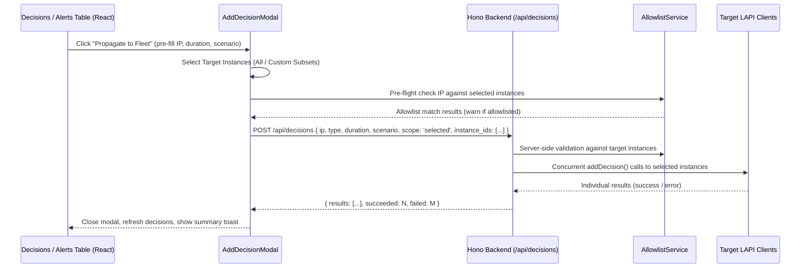

# Design Specification: Multi-Instance Decision Propagation (Fleet Orchestration)

**Feature:** Multi-Instance Decision Propagation & Granular Fleet Targeting  
**Branch:** `test`  
**Date:** 2026-11-14  
**Status:** Approved (Approach 1)

---

## 1. Executive Summary & Objective

In multi-instance deployments of CrowdSec Web UI (where multiple CrowdSec Local API instances are connected, e.g. edge gateways, cloud clusters, on-prem nodes), decisions are currently applied either to a single instance or strictly across all instances via a single boolean toggle. Furthermore, an active decision visible in the Decisions table on Instance A cannot be propagated to other instances without manually re-entering all decision parameters in a fresh modal.

This feature enables:
1. **Granular Multi-Instance Targeting**: Extending decision creation (both single `/api/decisions` and bulk `/api/decisions/bulk-add`) to target any arbitrary subset of instances (`scope: 'selected'` and `instance_ids: string[]`), not just `scope: 'all'` or `scope: 'instance'`.
2. **1-Click Fleet Propagation**: Providing a direct "Propagate to Fleet" action (`Globe` icon) on decision rows in `Decisions.tsx` and alert rows in `Alerts.tsx`, which opens `AddDecisionModal` pre-populated with the decision's IP, duration, type, and scenario, defaulting to all instances or custom selected targets.
3. **Idempotent Per-Instance Results & Allowlist Protection**: Ensuring allowlist checks evaluate all targeted instances concurrently and that per-instance outcomes (success, already active, allowlisted, failed) are cleanly audited and displayed to the user.

---

## 2. Architecture & Data Flow



---

## 3. Subsystem Changes & Interfaces

### 3.1. Shared Contracts (`shared/contracts.ts`)
- Update `AddDecisionRequest`:
  ```typescript
  export interface AddDecisionRequest {
    ip: string;
    duration?: string;
    reason?: string;
    type?: 'ban' | 'captcha';
    scenario?: string;
    scope?: 'all' | 'instance' | 'selected';
    instance_id?: string;
    instance_ids?: string[];
    bypass_allowlist?: boolean;
  }
  ```
- `BulkAddDecisionRequest` automatically inherits these fields because it extends `Omit<AddDecisionRequest, 'ip'>`.

### 3.2. Backend Core (`server/app.ts` & `server/app/api-routes.ts`)
- Update `resolveOperationInstances`:
  ```typescript
  function resolveOperationInstances(
    scope: 'all' | 'instance' | 'selected' | undefined,
    instanceId: string | undefined,
    instanceIds?: string[],
  ): RuntimeConfig['instances'] | { error: string } {
    if (!scope) return [primaryInstance];
    if (scope === 'all') return config.instances;
    if (scope === 'selected' || (instanceIds && instanceIds.length > 0)) {
      const ids = new Set(instanceIds || []);
      const matching = config.instances.filter((candidate) => ids.has(candidate.id));
      return matching.length > 0
        ? matching
        : { error: 'At least one valid instance_id is required when scope is selected' };
    }
    const instance = config.instances.find((candidate) => candidate.id === instanceId);
    return instance ? [instance] : { error: 'A valid instance_id is required when scope is instance' };
  }
  ```
- In `server/app/api-routes.ts`:
  - Pass `body.instance_ids` to `resolveOperationInstances(body.scope, body.instance_id, body.instance_ids)` in `/api/decisions` and `/api/decisions/bulk-add`.
  - Pass target instances array to `allowlistService.checkValue(targets, ip)`.
  - Audit logging already records all target instances: `instances: results.map((result) => result.instance_name)`.

### 3.3. Frontend Components

#### 3.3.1. `client/src/components/AddDecisionModal.tsx`
- Replace single boolean `allInstances` state with an instance selection mode:
  - `targetScope: 'current' | 'all' | 'custom'`
  - `selectedInstanceIds: Set<string>`
- Provide segmented buttons or radio pills:
  - `[ Current Instance ]` (if opened from a specific instance)
  - `[ All Instances (N) ]`
  - `[ Specific Instances... ]`
- When "Specific Instances" is selected, render a compact grid of instance badges/checkboxes with "Select All" and "Deselect All" convenience buttons.
- Dynamically calculate scenario compatibility:
  - Compute intersection of supported manual scenarios for selected instances, falling back to `DEFAULT_MANUAL_DECISION_SCENARIO` if lists diverge.
- Ensure the real-time allowlist pre-flight check evaluates against all selected instances.

#### 3.3.2. `client/src/pages/Decisions.tsx`
- In the actions column for each decision row, add a new action button when `multipleInstances` is true:
  - Button with `Globe` icon (or `Share2` icon): `title={t('pages.decisions.propagateToFleet', { defaultValue: 'Propagate decision to all instances' })}`.
  - On click, sets `propagateDecision`:
    ```typescript
    setPendingPropagateDecision({
      ip: decision.value || '',
      duration: isExpired ? '4h' : decisionDuration,
      reason: decision.message || 'manual propagation',
      scenario: decision.scenario,
      originInstanceId: decision.instance_id,
    });
    ```
  - Opens `AddDecisionModal` with `defaultAllInstances={true}`, with the original instance and other instances clearly displayed.

#### 3.3.3. `client/src/pages/Alerts.tsx`
- In `Alerts.tsx`, when clicking "Add Decision" on an alert:
  - `pendingDecisionAlert` opens `AddDecisionModal` where analysts can easily toggle between banning solely on the reporting instance or propagating across all instances.

### 3.4. Localization (`client/src/locales/*.json`)
- Add translation keys for:
  - `pages.decisions.propagateToFleet`: "Propagate ban to all instances"
  - `pages.decisions.targetScope`: "Target Instances"
  - `pages.decisions.targetScopeCurrent`: "Current Instance"
  - `pages.decisions.targetScopeAll`: "All Instances ({{count}})"
  - `pages.decisions.targetScopeCustom`: "Select Instances"
  - `pages.decisions.selectAll`: "Select All"
  - `pages.decisions.deselectAll`: "Deselect All"

---

## 4. Error Handling & Edge Cases

1. **Partial Failures across Fleet**:
   - If 2 out of 3 instances succeed and 1 fails (e.g. timeout on edge node), backend returns HTTP 207 (Multi-Status) with `results: [...]`.
   - `AddDecisionModal` displays a retry button specifically listing the failed instance(s).
2. **Allowlist Conflicts**:
   - If IP is allowlisted on Instance B but not Instance A:
   - Allowlist pre-flight check flags Instance B specifically.
   - User can check `[x] Bypass allowlist` to enforce on all instances, or uncheck Instance B in custom selection.
3. **Differing Manual Decision Scenarios**:
   - If Instance A has custom scenarios `[custom-ban, ip-block]` and Instance B has default `[manual]`, the selector falls back to the globally valid `manual` scenario.

---

## 5. Testing Strategy

1. **Server Unit & Integration Tests**:
   - `server/__tests__/app/api-decisions.test.ts`:
     - Test adding decision with `scope: 'selected'` and `instance_ids: ['inst-1', 'inst-2']`.
     - Test error handling when `instance_ids` contains invalid or non-existent IDs.
     - Test bulk adding decisions with `scope: 'selected'`.
2. **Client Unit & Component Tests**:
   - `client/src/components/__tests__/AddDecisionModal.test.tsx`:
     - Test switching between `current`, `all`, and `custom` instance targets.
     - Test selecting/deselecting individual instances.
     - Test allowlist check payload includes all selected instances.
   - `client/src/pages/__tests__/decisions/actions.test.tsx`:
     - Test clicking "Propagate to Fleet" opens `AddDecisionModal` with `allInstances` active and populated fields.
3. **Regression & Coverage**:
   - Run `pnpm run coverage` to ensure lines, functions, and branches meet the 90% threshold.
